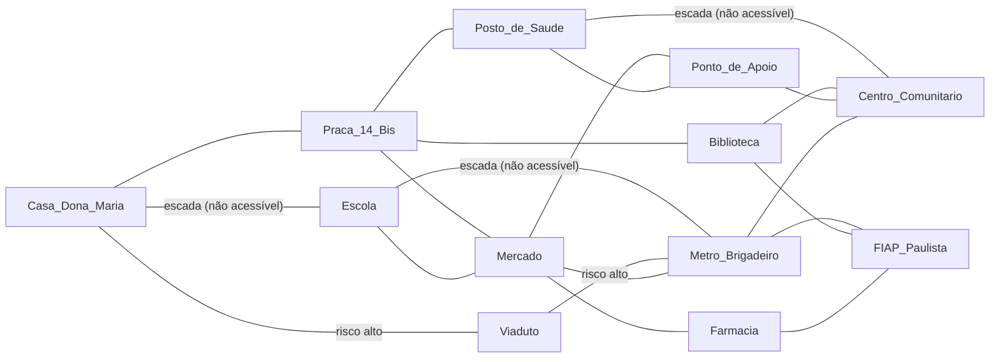

# CaminhoSeguro — Dynamic Programming (GS CitizenTech 2026.2)

**FIAP — Engenharia de Software, turma 2ESPH** | Disciplina: Dynamic Programming

| Nome | RM |
|---|---|
| Lucas Branquinho | 562262 |
| Vitor Bordalo | 561592 |

## Ficha da CitizenTech

| Campo | Resposta |
|---|---|
| Nome | **CaminhoSeguro** |
| Cidade e bairro | São Paulo/SP, bairro Bela Vista |
| Cidadão beneficiado | Pessoas com mobilidade reduzida e idosos que moram ou circulam na Bela Vista. Persona de exemplo: dona Maria, 72 anos (**fictícia** nesta entrega) |
| Problema | Calçadas irregulares, escadarias e travessias de risco fazem moradores com mobilidade reduzida desistirem de sair de casa ou correrem risco no caminho |
| Papel desta disciplina | Calcular a rota mais rápida, mais segura ou mais acessível e decidir quais melhorias fazer com um orçamento limitado |
| Repositório | https://github.com/lucasfbranquinho/citizentech-caminhoseguro (pasta `06-dynamic-programming`) |
| Indicador de impacto | % de trechos acessíveis, % de pares de locais com rota acessível e custo médio da rota acessível (calculados pelo `indicadores.py`) |
| ODS | **11** (cidades e comunidades sustentáveis): ruas acessíveis e seguras; **10** (redução das desigualdades): quem tem mobilidade reduzida passa a ter o mesmo acesso a saúde, escola e transporte; **3** (saúde e bem-estar): rota segura até o posto de saúde e menos risco de queda |

> **Dados simulados.** Os pontos do bairro (Casa de dona Maria, Praça 14 Bis, Posto de Saúde, Escola,
> Metrô Brigadeiro, FIAP Paulista etc.) são referências genéricas ou conhecidas da região, mas os
> **tempos, riscos, custos e benefícios em `dados/bairro.json` são inventados para a simulação**
> (não são medições reais). Não há nenhum dado pessoal real.

### As seis perguntas, em resumo
1. **Quem?** Moradores com mobilidade reduzida e idosos da Bela Vista.
2. **Qual problema?** Chegar ao posto, à escola e ao metrô por caminhos que sejam seguros e acessíveis.
3. **Como funciona?** O morador (ou um app) pede uma rota; o programa devolve o melhor caminho para o
   perfil escolhido e a associação de moradores descobre quais melhorias dão mais resultado.
4. **Tecnologias?** Python 3 (só biblioteca padrão), JSON para os dados, `unittest` para os testes.
5. **Ecossistema?** Moradores, associação do bairro, prefeitura/subprefeitura, UBS, escolas e a equipe.
6. **Medir e ampliar?** Pelos três indicadores acima, trocando o JSON por dados reais de outros bairros.

## Como rodar

Só precisa de Python 3.9+ (biblioteca padrão, nenhuma instalação). Dentro desta pasta:

```bash
python main.py                                  # roda todos os casos de exemplo (~3 s)
python main.py --menu                           # menu interativo
python main.py --rota Casa_Dona_Maria Posto_de_Saude --perfil segura
python main.py --rota Casa_Dona_Maria Metro_Brigadeiro --parada Farmacia
python main.py --orcamento 30                   # mochila com outro orçamento (mil R$)
python -m unittest -v                           # 21 testes automáticos
```

Perfis de rota: `rapida`, `segura` e `acessivel`. Os nomes dos locais estão em `dados/bairro.json`.

## Estrutura

| Arquivo | Conteúdo |
|---|---|
| `dados/bairro.json` | Dados simulados: 12 locais, 20 trechos de rua, orçamento e 8 melhorias possíveis |
| `grafo.py` | Lista de adjacência, leitura e validação do JSON, perfis de custo |
| `rotas.py` | Dijkstra, Floyd-Warshall (tabulação), rota com parada, ranking de pontos de apoio, menor custo com limite de trechos (memoização) |
| `orcamento.py` | Mochila 0/1 com memoização, com tabulação e sem memoização; aplicação das melhorias no grafo |
| `indicadores.py` | Indicadores de impacto antes e depois das melhorias |
| `eficiencia.py` | Medição de chamadas e tempo, com dados sintéticos maiores |
| `main.py` | Linha de comando, menu e casos de exemplo |
| `prompts.md` | Registro dos prompts de IA usados nesta disciplina |
| `tests/test_algoritmos.py` | 21 testes com respostas conhecidas |

## O grafo e os perfis de custo

Cada local é um nó e cada trecho de rua é uma aresta nos dois sentidos, com `tempo` (min), `risco`
(0–10) e `acessivel` (sim/não). O **perfil** transforma isso em um único custo:

| Perfil | Custo do trecho | Para quem |
|---|---|---|
| `rapida` | tempo | quem tem pressa |
| `segura` | tempo + 3 × risco | quem prefere evitar trechos perigosos |
| `acessivel` | tempo + 3 × risco, **proíbe** trechos não acessíveis (escadas) | cadeirantes, idosos, carrinho de bebê |

Estrutura escolhida: **lista de adjacência** (dicionário de dicionários). Um bairro tem poucas
ruas por esquina, então o grafo é esparso e a lista gasta O(V + E) de memória contra O(V²) de uma
matriz.

### Mapa do bairro (dados simulados)



## Algoritmos

1. **Dijkstra** (`rotas.dijkstra`): menor custo de um local até todos os outros, com fila de
   prioridade (`heapq`). Funciona porque nenhum custo é negativo (o `montar_grafo` valida isso).
   Tempo O((V + E) log V). Usado nas rotas do dia a dia.
2. **Floyd-Warshall — tabulação** (`rotas.floyd_warshall`): preenche de baixo para cima a tabela
   `dist[i][j]` com o menor custo entre **todos** os pares, liberando um ponto de passagem `k` por
   vez: `dist[i][j] = min(dist[i][j], dist[i][k] + dist[k][j])`. Tempo O(V³), espaço O(V²). Com a
   tabela pronta, duas funcionalidades viram consulta imediata:
   - **Rota com parada** (`rota_com_parada`): ir de casa ao metrô passando na farmácia custa
     `dist[casa][farmácia] + dist[farmácia][metrô]`.
   - **Ponto de apoio ideal** (`ranking_pontos_de_apoio`): onde pôr banco, sombra ou bebedouro?
     No local com a menor soma de custos até todos os outros (resultado nos dados: Mercado).
3. **Menor custo com no máximo k trechos — memoização** (`rotas.menor_custo_com_limite`):
   `f(local, k) = min(custo(local, v) + f(v, k-1))`, com `f(destino, k) = 0` e
   `f(local, 0) = ∞`. Responde "não quero uma rota com mais de k esquinas". Sem memoização o mesmo
   `(local, k)` é recalculado muitas vezes (cresce como grau^k); com um dicionário cada par é
   calculado uma vez: O(V · k · grau).
4. **Mochila 0/1 — memoização e tabulação** (`orcamento.py`): escolhe as melhorias de maior
   benefício (pessoas beneficiadas, estimativa simulada) sem passar do orçamento.
   `melhor(i, c) = max(melhor(i+1, c), benefício_i + melhor(i+1, c − custo_i))`. As duas versões usam
   a mesma recorrência e dão o mesmo resultado. A tabulação monta a tabela `(n+1) × (orçamento+1)`
   (O(n · orçamento)) e reconstrói quais melhorias entraram. Cada melhoria é feita 0 ou 1 vez, por
   isso é a mochila 0/1 (e não gulosa: pegar o maior benefício por real nem sempre é o ótimo).
5. **Integração e impacto** (`orcamento.aplicar_melhorias` e `indicadores.py`): as melhorias
   escolhidas viram um **novo grafo** (rampa torna o trecho acessível; iluminação reduz o risco) e as
   rotas e os indicadores são recalculados, mostrando o bairro antes e depois.

### Por que Programação Dinâmica aqui?
Nos três casos o problema grande se divide em subproblemas que **se repetem**: (local, trechos
restantes) na rota limitada, (item, orçamento restante) na mochila e (i, j, k) no Floyd-Warshall.
Guardar a resposta de cada subproblema (memoização de cima para baixo, tabulação de baixo para
cima) evita refazer a mesma conta. O Dijkstra entra como algoritmo de referência para conferir os
resultados e para consultas de uma única origem.

## Resultados dos exemplos (saída real do `main.py`)

- `Casa Dona Maria → Metrô Brigadeiro`: `rapida` passa pelo Viaduto (custo 10, risco alto); `segura`
  e `acessivel` vão por Praça 14 Bis > Mercado > Metrô (custo 36).
- `Casa Dona Maria → Escola`: `rapida` e `segura` usam a escadaria (4 e 22); `acessivel` faz a
  volta por Praça 14 Bis > Mercado > Escola (38).
- Rota passando na Farmácia até o Metrô (perfil acessível): custo 48.
- Orçamento de R$ 50 mil: benefício máximo **113 pessoas** (rampa Casa-Escola, iluminação do
  Viaduto, câmera e iluminação Viaduto-Metrô e bebedouro), gastando exatamente 50.
- Depois dessas melhorias: trechos acessíveis 85% → 90%; custo médio da rota acessível 24,8 → 21,5;
  a rota acessível até a Escola cai de 38 para 22 e até o Metrô de 36 para 22.

## Eficiência (saída do `main.py`; os tempos variam por máquina)

| Caso | Sem memoização | Com memoização / tabulação |
|---|---|---|
| Rota com até 12 trechos | ~1,8 milhão de chamadas, ~1 s | 347 chamadas, ~0,2 ms |
| Mochila, 8 melhorias do bairro | 308 chamadas | 181 chamadas (memo.) e 459 células (tab.) |
| Mochila, 22 melhorias sintéticas | ~6,6 milhões de chamadas, ~1,3 s | ~2,7 mil chamadas, ~1 ms (memo.) e ~0,3 ms (tab.) |

- **Mochila:** com os 8 itens reais a diferença é pequena. Ela só aparece de verdade com mais
  itens: sem memoização as chamadas dobram a cada item (2ⁿ), enquanto memoização e tabulação
  crescem com n × orçamento. Por isso o `main.py` também mede conjuntos sintéticos (gerados com
  semente fixa, só para teste de desempenho).
- **Grafo:** em grades sintéticas de 16, 36, 64 e 100 locais, o Floyd-Warshall leva por volta de 1,
  8, 40 e 150 ms (crescimento ~V³). Rodar Dijkstra a partir de cada local é mais rápido
  (≈0,4, 2, 7 e 19 ms): para um bairro grande e consultas de uma origem só, Dijkstra é a melhor
  escolha. O Floyd-Warshall vale pela tabela completa, que permite consultas O(1), rotas com
  parada e o ranking de pontos de apoio.
- **Tabulação x memoização:** a tabulação não usa recursão (sem risco de estourar a pilha) e
  preenche todas as células; a memoização só calcula os estados que a pergunta realmente alcança.

## Testes (`python -m unittest -v`, 21 testes)

- Dijkstra e Floyd-Warshall em grafo pequeno de resposta conhecida; um contra o outro nos dados do
  bairro, nos três perfis, e em grades sintéticas.
- Perfil acessível bloqueando escada; grafo desconexo (sem rota); validação de dados inválidos.
- Rota com limite de trechos: respeita o limite, bate com o Dijkstra e com a versão sem memoização,
  e faz muito menos chamadas.
- Rota com parada (inclusive com desvio e com destino inalcançável) e ranking de pontos de apoio.
- Mochila: caso clássico (orçamento 50 → 220), orçamento zero, comparação com **força bruta**
  (todos os subconjuntos) para vários orçamentos, memoização = tabulação = recursão pura, e escolhas
  que cabem no orçamento.
- Melhorias: a rampa abre a rota acessível (38 → 22), os indicadores melhoram (85% → 90%) e o grafo
  original não é alterado.

## Limitações (o que o código não faz)

- Os pesos (3 × risco), os riscos e os benefícios são **simulados**; num caso real viriam de
  ocorrências da comunidade e de dados públicos, e os pesos precisariam ser calibrados.
- O grafo é pequeno e estático: não considera horário (iluminação à noite), chuva ou obras.
- A mochila trata cada melhoria como independente: o benefício de duas rampas juntas é a soma dos
  benefícios, sem sobreposição. Os indicadores antes e depois conferem o efeito real no grafo.
- Floyd-Warshall (O(V³)) não é a melhor escolha para bairros com milhares de locais; nesse caso o
  Dijkstra por origem, ou mantendo só as rotas mais consultadas, escala melhor.

## Como adaptar a outro bairro ou tema

Basta editar `dados/bairro.json` (ou passar outro arquivo com `--dados`): trocar os locais pelos
pontos reais do bairro, ajustar `tempo`, `risco` e `acessivel` de cada trecho (por exemplo com as
ocorrências registradas pela comunidade e analisadas na disciplina de Data Science) e listar as
ações da prefeitura em `melhorias` com `custo` e `beneficio`. Os algoritmos não mudam. Se o tema
pedir outro critério, é só trocar a fórmula em `PERFIS`, no `grafo.py`.

## Uso de IA

Usamos IA (Claude) como copiloto; os prompts estão registrados no `prompts.md` desta pasta (e no da
equipe, no repositório) e cada integrante sabe explicar o código.
